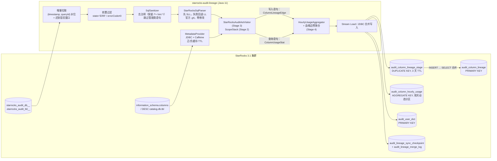
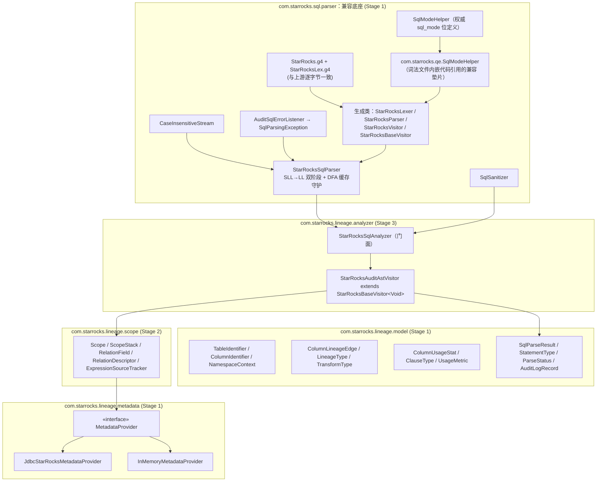
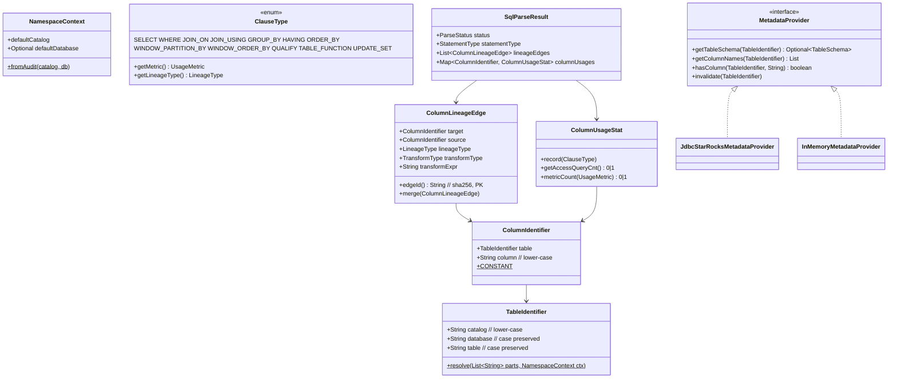

# Stage 1：架构蓝图、StarRocks 3.1.x 存储 DDL、Maven 工程与 `.g4` 兼容底座

> 状态：**已签字（SIGNED-OFF）**，`mvn test` 共 134 个用例全部通过。
> 上游语法来源：`StarRocks/starrocks` 仓库 `branch-3.1` 分支，路径 `fe/fe-core/src/main/java/com/starrocks/sql/parser/`，于 2026-11-09 拉取。
> `StarRocks.g4` 的 sha256 为 `cc04fb2c…5902e3`，`StarRocksLex.g4` 的 sha256 为 `207d0c01…f4d9b0`，由 `OfficialGrammarIntegrityTest` 守护。

---

## 📐 STEP 1：【首席架构师】架构设计与契约定义

### 1.1 端到端数据流

### 1.2 解析引擎模块架构

### 1.3 存储模型（DDL 位于 `sql/ddl/`）

| 文件 | 表 | 模型 | 关键设计 |
|---|---|---|---|
| `01_audit_column_lineage.sql` | `audit_column_lineage` | PRIMARY KEY(`edge_id`) | `edge_id` = SHA-256(目标四元组, 源四元组, lineage_type)（原因见 R-03）；排序键 `ORDER BY (target_db, target_table, target_column)`；在 `source_table, source_column, target_table` 上建 Bloom Filter；开启持久化索引 |
| `02_audit_column_lineage_stage.sql` | `audit_column_lineage_stage` | DUPLICATE KEY | 每个批次的 Stream Load 落地表，保留 3 天动态分区；文件内附带 MERGE SQL：`exec_count` 累加、`first_seen_time` 取 LEAST、`last_*` 取最新一条语句的值 |
| `03_audit_column_hourly_usage.sql` | `audit_column_hourly_usage` | AGGREGATE KEY(`stat_hour, catalog_name, db_name, table_name, column_name`) | 对 `stat_hour` 做 RANGE 分区，按天动态分区并保留 400 天；分桶键 `HASH(db_name, table_name)`；计数列用 SUM；`user_bitmap` 为 BITMAP_UNION，`user_hll` 为 HLL_UNION；另有 `max_query_time_ms`（MAX）和 `last_access_time`（MAX） |
| `04_audit_user_dict.sql` | `audit_user_dict` | PRIMARY KEY(`user_name`) | 稠密且无碰撞的 `user_id`，用于精确 UV 位图（见 R-04） |
| `05_audit_lineage_sync_checkpoint.sql` | `audit_lineage_sync_checkpoint`, `audit_lineage_merge_log` | PRIMARY KEY | `(timestamp, queryId)` 水位；单写者租约；按批次幂等合并 |

> 注（Stage 4 更新）：`02` 中按 `merge_log` 判重的设计已被 **R4-01** 取代，改为在血缘表上增加 `last_batch_id` 列，由合并语句自身防重；`05` 中增加了批次意图三列（**R4-02**）。详见 `docs/stage4-pipeline.md`。

**用量表加载契约**：每个 `(stat_hour, column, user)` 发出**一行**，内容是该用户在该小时、该列上的小计。SUM 指标逐行相加即得列总量；每行带一个单用户的 bitmap 和 HLL，二者合并后就是该列的 UV。这样不需要在客户端序列化 bitmap，跨小时、天、月上卷时 UV 也不会失真。

**业务查询**（`sql/query/business_queries.sql`）：
- Q1：某列逐小时的访问次数、各子句频次、精确/近似 UV、资源水位；
- Q2：按天上卷；
- Q3：热度 Top-50 的列；
- Q4：冷列（与 `information_schema` 做反连接）；
- Q5：经字典把位图解码成用户名；
- Q6/Q7：上游/下游一跳血缘；
- Q8：多跳遍历（3.1 不支持递归 CTE）。

### 1.4 领域契约

**契约细则**

1. **三层命名空间补全**（`TableIdentifier.resolve`）：
   - `t` 补全为 `ctx.catalog.ctx.db.t`；会话未选库时抛出 `UnresolvedNameException`；
   - `db.t` 补全为 `ctx.catalog.db.t`；
   - `c.db.t` 原样保留；
   - 名字超过 3 段直接拒绝。

   **CTE 名、Lambda 形参、UNNEST 别名必须先在 ScopeStack 里查，查不到才调用 `resolve`**（这是 Stage 2 的硬约束）。
2. **名字规范化**（`Identifiers`）：
   - catalog 和列名转小写，因为 StarRocks 对这两者大小写不敏感；
   - db 和表名保持原样，因为 StarRocks 对这两者大小写敏感；
   - 反引号会被剥离，`` ` `` 双写会被还原。
3. **审计命名空间**（`NamespaceContext.fromAudit`）：
   - `db` 形如 `catalog.db` 时拆开（StarRocks 的库名不允许包含 `.`）；
   - 去掉旧版本遗留的 `default_cluster:` 前缀。
4. **血缘边的身份**是 `(target, source, lineageType)`，也就是存储层主键；`transformType` 按 `CONSTANT < IDENTITY < EXPRESSION < AGGREGATION < WINDOW` 取支配者。字面量来源统一用 `ColumnIdentifier.CONSTANT` 哨兵表示，保证主键非空。
5. **用量计数语义**：
   - 单条 Query 内，同一物理列的 `access_query_cnt` 恒为 1；
   - 5 个子句指标按"该列是否在映射到该指标的子句中出现过"取 0 或 1。
   - `ClauseType → UsageMetric` 的映射如下：
     - HAVING 和窗口 PARTITION BY 计入 `group_by_cnt`；
     - 窗口 ORDER BY 计入 `order_by_cnt`；
     - QUALIFY 计入 `where_clause_cnt`；
     - UNNEST 的实参只计 `access_query_cnt`。
6. **MetadataProvider**：
   - 实现必须线程安全；
   - 表不存在时返回 `Optional.empty()`，不能抛异常；
   - 基础设施故障抛 `MetadataAccessException`，并且**不进缓存**；
   - 返回的列序就是建表顺序（`SELECT *` 展开和省略列名的 `INSERT` 依赖这一点）。
7. **审计失败过滤**：满足 `state` 等于 `ERR`（不区分大小写），或 `errorCode` 非空且不为 `"0"`，即视为失败。3.1 中 `errorCode` 是 VARCHAR，所以按文本比较。

---

## 💻 STEP 2：【核心开发工程师】生产级代码实现

| 模块 | 文件 |
|---|---|
| 构建 | `pom.xml`：antlr4-maven-plugin 4.9.3（只编译根语法 `StarRocks.g4`，`StarRocksLex.g4` 经 `libDirectory` 导入）、Caffeine、mysql-connector-j、HikariCP、httpclient5（Stream Load）、Jackson、SLF4J/Logback、JUnit 5、H2（测试） |
| 官方语法 | `src/main/antlr4/com/starrocks/sql/parser/StarRocks.g4`、`StarRocksLex.g4`（零修改） |
| 兼容底座 | `com.starrocks.qe.SqlModeHelper`、`com.starrocks.sql.parser.{SqlModeHelper, CaseInsensitiveStream, AuditSqlErrorListener, SqlParsingException, SqlSanitizer, StarRocksSqlParser}` |
| 领域模型 | `com.starrocks.lineage.model.{Identifiers, NamespaceContext, TableIdentifier, ColumnIdentifier, ColumnLineageEdge, ColumnUsageStat, ClauseType, UsageMetric, LineageType, TransformType, StatementType, ParseStatus, SqlParseResult, AuditLogRecord, UnresolvedNameException}` |
| 元数据 | `com.starrocks.lineage.metadata.{MetadataProvider, TableSchema, ColumnMetadata, MetadataAccessException, InMemoryMetadataProvider, JdbcStarRocksMetadataProvider}` |
| 测试（134 个） | `OfficialGrammarIntegrityTest`、`GrammarNodeAlignmentTest`、`StarRocksSqlParserTest`、`SqlSanitizerTest`、`SqlModeHelperTest`、`IdentifierModelTest`、`LineageAndUsageModelTest`、`InMemoryMetadataProviderTest`、`JdbcStarRocksMetadataProviderTest`（H2） |

关键实现要点：
- **双阶段解析**：
  1. 先调用 `tokens.fill()`，让词法错误一次性暴露，避免和 SLL 预测失败混淆；
  2. 用 SLL + `BailErrorStrategy` 解析；
  3. 出现 `ParseCancellationException` 时执行 `seek(0)` 和 `reset()`，再用 LL + `DefaultErrorStrategy` 重新解析，语法错误由 `AuditSqlErrorListener` 转成带行列号的 `SqlParsingException`。
- **大小写**：`CaseInsensitiveStream` 只把 `LA()` 转成大写，`getText()` 仍委托原始流，因此标识符和字面量保持原样。
- **`||` 的语义**：词法内嵌代码通过 `com.starrocks.qe.SqlModeHelper.MODE_PIPES_AS_CONCAT` 判断，测试验证了默认是 `LOGICAL_OR`，开启 `PIPES_AS_CONCAT` 后是 `CONCAT`。
- **`SqlSanitizer`**：
  - 用状态机识别字符串和反引号，不会误删 `'-- x'` 这类字面量；
  - 删除 `/* */`、`--`、`#` 注释，保留 `/*+ hint */`；
  - 删掉注释的位置补一个空格，防止前后 token 粘连；
  - 跳过前导括号和 hint 后识别首个关键字，以此判定管理类语句。
- **`JdbcStarRocksMetadataProvider`**：
  - `default_catalog` 走 `information_schema.columns`（参数绑定），外部 catalog 走 `DESC \`c\`.\`db\`.\`t\``；
  - 用 Caffeine 的 `Expiry` 区分正/负缓存 TTL；
  - "表不存在"的判定依据：错误码 1049、1146、1051，SQLSTATE 42S02，或错误信息中的关键字。

---

## 🔍 STEP 3：【首席架构师】Code Review 与【核心开发工程师】修正闭环

### 3.1 发现与修正

| # | 级别 | 铁律 | 发现 | 修正（已合入） | 验证 |
|---|---|---|---|---|---|
| R-01 | 阻断 | #1 | 规范描述的 `.g4` 与上游 branch-3.1 实际不符，具体有五点：①上游文件名为 **`StarRocks.g4`**（combined grammar，`import StarRocksLex;`），不存在 `StarRocksParser.g4`；②目录在 `src/main/java/...` 而不是 `antlr4/`；③词法 `@members` 引用的是 **`com.starrocks.qe.SqlModeHelper`**，没有 `@header` 和 `isHint()`；④生成的基类是 **`StarRocksBaseVisitor`**，不是 `StarRocksParserBaseVisitor`；⑤`visitFromClause` / `visitUnnestRelation` / `visitLateralView` / `visitDereferenceExpression` 在 3.1 中**不存在**。 | 新增 `com.starrocks.qe.SqlModeHelper` 垫片，委托给 `com.starrocks.sql.parser.SqlModeHelper`。pom 只编译根语法，用 `libDirectory` 解析 import。Stage 3 节点矩阵改为：`visitFrom` / `visitDual`；UNNEST 走 `visitTableFunction`（`qualifiedName` 为 `UNNEST`）或 `visitNormalizedTableFunction`；LATERAL 是 `relations` / `joinRelation` 中的关键字 token；解引用用 `visitDereference`。 | `GrammarNodeAlignmentTest`（53 个用例）、`OfficialGrammarIntegrityTest` |
| R-02 | 主要 | #1 | Windows 环境或 `core.autocrlf` 下检出会改写 `.g4` 的换行符，破坏"逐字节一致"。 | 在 `.gitattributes` 中加入 `*.g4 -text`。 | sha256 断言 |
| R-03 | 主要 | DDL | 9 列自然主键（VARCHAR 最长 9×256B）超出 StarRocks 3.1 Primary Key 表 **128 字节**的编码主键上限，而且 PK 表在 upsert 时无法对 `exec_count` 做 SUM。 | 主键改为 `edge_id VARCHAR(64)` = SHA-256，自然键降为普通列；加 `ORDER BY` 排序键，保证按目标列查询仍走前缀索引；新增 stage 表和 MERGE SQL（单写者，按 `merge_log` 幂等）。 | `LineageAndUsageModelTest.edgeId*` |
| R-04 | 阻断 | DDL | 在 branch-3.1 的 `gensrc/script/functions.py` 中检索，**没有 `bitmap_hash64`**，只有 32 位的 `bitmap_hash`。规范给出的写法在 3.1 上导入时会报错；即便退回 32 位哈希，也存在碰撞，不能做到"精确 UV"。 | 新增 `audit_user_dict`，管道分配稠密 `user_id`，写入时用 `to_bitmap(user_id)`，得到精确且可无损上卷的 UV。HLL 继续用 `hll_hash(user)`。 | DDL 注释与 Q5 解码查询 |
| R-05 | 主要 | 稳定性 | ANTLR 的预测 DFA 缓存是静态的，只增不减。审计流里语句千变万化，长期运行会导致堆内存持续上涨。 | `StarRocksSqlParser` 每 N 次解析统计一次 DFA 状态数，超过阈值就 `clearDFA()`（parser 和 lexer 都清）。旧 DFA 对象由正在使用的线程继续安全持有，并提供监控用的计数器。 | `dfaGuardResetsTheSharedCacheAboveTheThreshold` |
| R-06 | 次要 | 命名空间 | 旧版本升级上来的集群，审计 `db` 列可能带 `default_cluster:` 前缀，会导致补全出错误的库名。 | 在 `NamespaceContext.fromAudit` 中剥离该前缀。 | `IdentifierModelTest` |
| R-07 | 次要 | 性能 | 每次调用 `edgeId()` 都重新计算 SHA-256，预聚合阶段会被高频调用。 | 改为 volatile 惰性缓存（良性竞争，结果确定）。 | 既有用例 |
| R-08 | 次要 | DDL | 无法在 3.1 文档中核实 `dynamic_partition.time_zone` 和 `history_partition_num` 两个属性。 | 删除这两个属性，分区时区沿用 FE 时区，避免建表失败。 | — |

### 3.2 铁律逐条核查（Stage 1 范围）

1. **`.g4` 节点对齐**：✅ 节点名已按 R-01 改正，并由测试固化。
2. **CTE / 子查询作用域**：Stage 2 负责。本阶段已在契约中写明"先查作用域，再补全命名空间"。
3. **`SELECT *` 与省略列名的 `INSERT`**：✅ `MetadataProvider` 保证返回建表列序，`TableSchema` 的序号连续 0..n-1，有测试覆盖。
4. **集合操作按位置对齐**：✅ `TableSchema` 和 `ColumnMetadata.ordinal` 提供下标基础；合并逻辑在 Stage 2/3 实现。
5. **UNNEST / Lambda / 窗口**：✅ 语法冒烟测试覆盖 `LATERAL UNNEST(a1, a2) AS u(c1, c2)`、`array_map((x, y) -> …)`、`OVER (PARTITION BY … ORDER BY …)`、`QUALIFY`；`ClauseType` 已预留 `TABLE_FUNCTION`、`WINDOW_*`、`QUALIFY`。
6. **ClauseType 栈**：✅ 枚举与指标映射已定，栈的实现在 Stage 3。
7. **单 Query 去重**：✅ 对 `SELECT a, a + 1 FROM t WHERE a > 10`，`access_query_cnt=1`、`select_clause_cnt=1`、`where_clause_cnt=1`，见 `usageIsDeduplicatedPerQueryAndPerClause`。
8. **零占位符**：✅ 自有代码中没有 TODO 或空实现。唯一的 `TODO` 位于上游 `StarRocks.g4` 第 2214 行（注释掉的 `WEEK(expr)`），属于官方原文，按零修改原则保留。

### 3.3 签字

【首席架构师】Stage 1 **APPROVED**。

进入 Stage 2 的前置约束：
- 访问器必须继承 `StarRocksBaseVisitor<Void>`；
- UNNEST 与 LATERAL 按 R-01 的映射实现；
- 用量写入遵循"每 (小时, 列, 用户) 一行"的契约。
