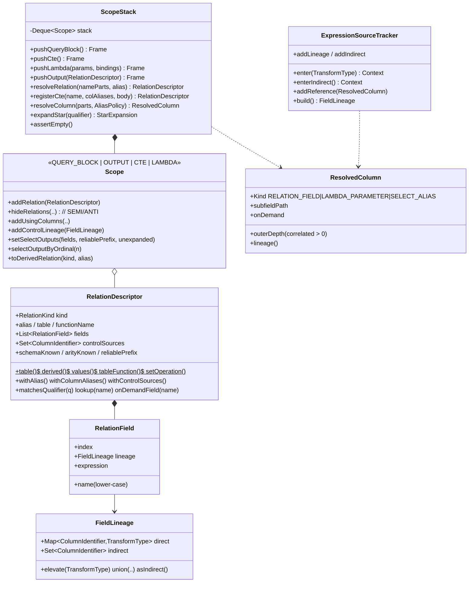
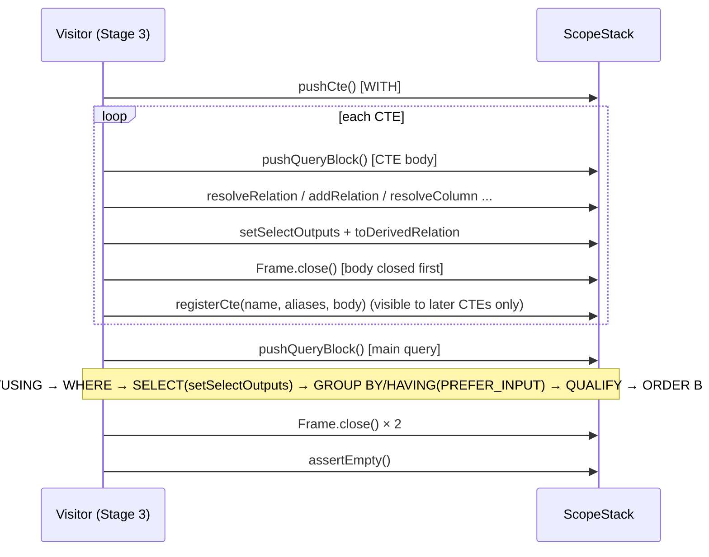

# Stage 2：符号表与作用域栈引擎（`Scope` / `ScopeStack` / `RelationField`）

> 状态：**已签字（SIGNED-OFF）**。`mvn test` 共 173 个用例全部通过，其中 Stage 2 新增 39 个。
> 代码位于 `com.starrocks.lineage.scope`。
> 语义依据：StarRocks `branch-3.1` 源码中的 `QueryAnalyzer`、`AstBuilder`、`Field`、`RelationFields`、`TableFunctionRelation`。

---

## 📐 STEP 1：【首席架构师】架构设计与契约定义

### 1.1 核心思想：任何字段都只用**物理列**表达血缘

每个关系（物理表、CTE、子查询、UNNEST、VALUES、集合操作）都是一张有序的 `RelationField` 列表。每个字段携带一个 `FieldLineage`，由两部分组成：
- `direct`：值流入的物理列，以及每一列各自的 `TransformType`；
- `indirect`：只对该字段有效的控制列，比如窗口函数的 `PARTITION BY` / `ORDER BY`。

行级控制（WHERE、JOIN、GROUP BY、HAVING、QUALIFY）作用于整个关系，所以挂在 `RelationDescriptor.controlSources` 上，而不是挂在字段上。

这样做的好处是：无论经过多少层 CTE 或子查询，外层字段都只需对内层字段的 `FieldLineage` 做组合（`elevate` / `union`），**永远不需要重新访问内层 AST**。CTE 被引用 N 次，主体也只分析一次。

### 1.2 作用域栈的生命周期（Stage 3 访问器必须遵守的调用顺序）

### 1.3 字段寻址算法（`ScopeStack.resolveColumn`）

从栈顶向外逐层查找：

1. **LAMBDA 作用域**：`parts[0]` 命中形参就直接返回 `LAMBDA_PARAMETER`。形参会屏蔽同名物理列，但限定名 `t.x` 不受影响。
2. **QUERY_BLOCK / OUTPUT 作用域**，即 `Scope.resolveLocal`：
   - ① 如果策略是 `PREFER_ALIAS`（ORDER BY）且名字只有一段，SELECT 别名优先。
   - ② **限定解释**，从最长限定前缀开始尝试：`k = min(3, n-1) … 1`，用 `parts[0..k)` 去匹配可见关系，规则与 StarRocks 的 `Field#matchesPrefix` 一致：
     - 有别名的关系只能用别名访问；
     - 无别名的物理表可以用 `t`、`db.t`、`catalog.db.t` 访问；
     - 比较不区分大小写。

     命中唯一关系后，`parts[k]` 是列名，`parts[k+1..]` 是 struct 子字段路径。
   - ③ **非限定解释**：把 `parts[0]` 当作列名，在所有可见关系中查找：
     - 只有 1 个命中，直接返回；
     - 多个命中时，如果该列是 USING 列，或各命中的 lineage 完全相同，取最左侧的那个；否则报 `AMBIGUOUS_COLUMN`；
     - 已知 schema 中无命中、但恰好只有一个 schema 未知的关系，就在它上面按需建字段；
     - 有多个 schema 未知的关系，报 `AMBIGUOUS_UNKNOWN_SCHEMA`。
   - ④ 如果策略是 `PREFER_INPUT`（GROUP BY / HAVING），最后才查 SELECT 别名。
   - SELECT 别名只在最内层查询块可见。
   - 本层未命中就继续向外查找，每跨出一个查询块，`outerDepth` 加 1（即关联子查询引用）。
3. **CTE 作用域**：对列名透明，直接跳过。
4. 遍历到栈底仍未命中，报 `COLUMN_NOT_FOUND`。

**关系寻址（`resolveRelation`）**：
1. 单段名字先按 CTE 查找，从内层 WITH 向外。内层同名 CTE 会屏蔽外层 CTE，也会屏蔽同名物理表。
2. 不是 CTE 时，用会话命名空间补全为三段名，再调用 `MetadataProvider` 取 schema。

CTE 只在主体分析完成**之后**注册，因此：
- `WITH t AS (SELECT * FROM t)` 中，主体里的 `t` 是物理表；
- 后定义的 CTE 可以引用先定义的 CTE。

### 1.4 关系代数契约（均已对照 3.1 源码核实）

| 场景 | 规则 | 依据 |
|---|---|---|
| `JOIN … USING (c)` | 只改写为 `l.c = r.c`，输出**保留两侧的列**，不合并；非限定 `c` 取左侧 | `QueryAnalyzer#visitJoin` / `analyzeJoinUsing` |
| `LEFT/RIGHT SEMI/ANTI JOIN` | 输出作用域只含一侧的列；被隐藏的一侧继续贡献控制列 | `QueryAnalyzer#visitJoin` |
| LATERAL 表函数 | 右侧以左侧作用域为父作用域；实参可以引用前面的关系 | `QueryAnalyzer#visitJoin` |
| `UNNEST(a1, …, an)` | 输出 n 列，未指定别名时**全部叫 `unnest`**；第 i 列的血缘 = 第 i 个实参的血缘提升为 `EXPRESSION` | `QueryAnalyzer#visitTableFunction` |
| 表函数默认别名 | `table_function_<fn>` | `TableFunctionRelation#getResolveTableName` |
| `VALUES` 默认列名 | `column_0 … column_{n-1}` | `AstBuilder#visitInlineTable` |
| 集合操作 | 列名取第一个分支；第 i 列 = 各分支第 i 列血缘的并集，**只看位置不看列名**；控制列取并集 | SQL 标准 / StarRocks |
| `SELECT *` | 按 FROM 中关系的顺序展开，每个关系内按建表列序；USING 列两侧都输出 | 同上 |

**完整性模型**（专门处理元数据缺失）：
- `schemaKnown`：列表是否已知。schema 未知的关系称为"开放关系"，被引用的列会按需生成。
- `arityKnown` / `isPositionallyComplete()`：列数与每一列的位置是否可靠。按位置对齐的消费者只依赖这一项。
- `reliablePrefix`：位置可靠的前导列数。`SELECT *` 遇到开放关系时，前缀到该关系为止。
- `unexpandedStarSources`：哪些开放关系的 `*` 没能展开。只要该集合非空，就说明血缘不完整。

---

## 💻 STEP 2：【核心开发工程师】生产级代码实现

| 文件 | 职责 |
|---|---|
| `FieldLineage.java` | 不可变的血缘值对象。`physical` / `constant` / `of` / `elevate` / `union` / `withIndirect` / `asIndirect` / `dominantTransform` |
| `RelationField.java` | 输出列：名字转小写、位置下标、血缘、源表达式文本 |
| `RelationKind.java` | `TABLE / CTE / SUBQUERY / TABLE_FUNCTION / VALUES / SET_OPERATION / QUERY_OUTPUT` |
| `RelationDescriptor.java` | 关系工厂（表、派生关系、VALUES、表函数、集合操作）；别名与列别名重命名；限定前缀匹配；开放关系上的按需字段（结果做了缓存）；完整性模型 |
| `Scope.java` | 四类作用域；FROM 命名空间（重复别名检测、SEMI 隐藏、USING 列）；块级控制列；SELECT 输出（供别名和序号引用）；本层寻址算法；`*` 展开 |
| `ScopeStack.java` | `Frame`（AutoCloseable，后进先出校验，检测栈污染）；深度上限；CTE 注册与查找；关系寻址（含外部 catalog 的大小写规范化）；跨层关联寻址；记录被引用的物理表 |
| `ResolvedColumn.java` | 寻址结果：类型、关系、字段、struct 子字段路径、`outerDepth`、是否按需生成；访问子字段时血缘提升为 `EXPRESSION` |
| `StarExpansion.java` | `*` 展开结果：列、可靠前缀、未展开的来源 |
| `ExpressionSourceTracker.java` | 表达式血缘累加器：转换上下文栈（取支配者）、间接上下文、逐源转换类型、引用清单（供用量统计）、`COUNT(*)` 的最强转换记录 |
| `AliasPolicy.java` | `NONE / PREFER_INPUT / PREFER_ALIAS`（遵循 MySQL 的 ORDER BY 与 GROUP BY/HAVING 别名优先级规则） |
| `SemanticAnalysisException.java` | 带 10 种 `ErrorCode` 的语义异常 |

测试（39 个）：
- `ColumnResolutionTest`：各种限定形式、别名、跨库同名表、USING 歧义、重复别名、struct 路径、开放关系、别名策略、Lambda 屏蔽、SEMI 隐藏、外部 catalog 大小写。
- `CteAndSubqueryScopeTest`：CTE 链组合、CTE 屏蔽、内外 WITH、多层关联、派生表、栈污染与泄漏、深度上限、作用域类型守卫。
- `RelationAlgebraTest`：`*` 顺序、不完整的 `*`、INSERT 按位对齐、集合操作按位合并与列数不一致、UNNEST、其他表函数、VALUES、列别名、控制列传播。
- `ExpressionSourceTrackerTest`：窗口函数、CASE WHEN、恒等与常量、组合、标量子查询、上下文顺序、血缘代数。

---

## 🔍 STEP 3：【首席架构师】Code Review 与【核心开发工程师】修正闭环

### 3.1 发现与修正

| # | 级别 | 铁律 | 发现 | 修正（已合入） | 验证 |
|---|---|---|---|---|---|
| R2-01 | 主要 | #3 #4 | 首版用 `isComplete()`（血缘完整）判断"位置是否可靠"，把两件事混为一谈。一个关系即使 `*` 来源未展开，只要已用列别名定死了列数，位置就是可靠的；首版却被判为不可靠，结果截断了后续关系的 `*` 可靠前缀，并且跳过了集合操作的列数校验。反过来，如果只用 `reliablePrefix == size` 判断，又会把"`*` 展开失败后恰好前缀等于已知列数"误判为位置可靠。 | 引入 `arityKnown` 和 `isPositionallyComplete()`。`expandStar`、`setOperation`、`withColumnAliases` 一律按位置完整性判断；血缘是否完整只看 `unexpandedStarSources`。 | `positionallyCompleteButLineageIncompleteRelationKeepsLaterPositionsReliable`、`setOperationArityMismatchAndIncompleteBranches` |
| R2-02 | 主要 | 命名空间 | 外部 catalog（Hive、Iceberg 等）不区分大小写，元数据里存的是小写名。SQL 写成 `HIVE.ODS.Events` 时会被当成开放关系，并以另一种拼写入库，导致同一张物理表拆成两组血缘或用量行。 | 在 `resolveRelation` 中，非 `default_catalog` 的表如果按原拼写找不到，就用小写名重试，命中后以元数据的拼写作为标识。`default_catalog` 的 OLAP 表名区分大小写，**不做回退**，以免映射到错误的表。 | `externalCatalogNamesAreCanonicalisedThroughMetadata` |
| R2-03 | 主要 | #2 | 编写测试时发现：如果在 CTE 主体作用域仍然打开时就注册 CTE，CTE 会在自己的主体内可见，造成自引用或屏蔽错误。 | `registerCte` 要求栈顶必须是 WITH 作用域，也就是主体已经关闭，否则抛 `SCOPE_STATE`。时序图中写明了正确顺序。 | `cteChainComposesLineageAndControlThroughEveryLayer` |
| R2-04 | 次要 | #6 | 别名优先级没有写明依据。 | 写入 `AliasPolicy` 的文档：ORDER BY 先查 SELECT 别名，GROUP BY / HAVING 先查 FROM 中的列（MySQL 规则）。 | `selectAliasPolicies` |
| R2-05 | 接受风险 | #2 | 子查询中的非限定列，如果本层只有一个开放关系、外层又有已知同名列，按 StarRocks"本层优先"的语义会归到本层的开放关系，在元数据缺失时可能归错。 | 保持本层优先（与 StarRocks 一致），同时打上 `ResolvedColumn.isOnDemand()` 标记。Stage 3 会把这类解析计为"降级"并在结果中暴露。 | `unknownSchemaRelationsResolveOnDemand` |
| R2-06 | 接受风险 | #2 | 非限定列命中多个关系、但各命中的血缘完全相同（例如同一物理表自连接）时没有报歧义。 | 血缘相同时结果确定，不影响血缘的正确性。StarRocks 自身会拒绝这种写法，因此成功执行的审计 SQL 中不会出现。 | 代码注释 |

### 3.2 铁律逐条核查（Stage 2 范围）

1. **节点对齐**：作用域 API 与 3.1 的 AST 语义一致（USING、SEMI、LATERAL、UNNEST、VALUES 的命名规则均已对照源码核实）。✅
2. **CTE 与子查询隔离**：
   - CTE 链（c2 引用 c1）把 `orders.amount` 组合为 `AGGREGATION`，c1 的 WHERE 与 c2 的 GROUP BY 都传到外层的控制列；
   - 内层同名别名会屏蔽外层，退出内层后外层恢复可见；
   - 两层关联引用的 `outerDepth` 分别为 1 和 2；
   - 关闭顺序错误会被拒绝，并且**不会弹出任何作用域**；异常退出时 try-with-resources 能把栈清空；`assertEmpty` 能检出泄漏。✅
3. **`SELECT *` 与 INSERT 对齐**：按 FROM 顺序加建表列序展开，`t1.*` 的第 i 列与目标表第 i 列逐一对应；遇到开放关系时可靠前缀截断，下游据此知道只能信任前 N 列。✅
4. **集合操作按位置对齐**：只按位置合并，不看列名；位置完整的分支列数不一致时报 `SET_OPERATION_ARITY_MISMATCH`；位置不完整的分支只合并可靠前缀部分。✅
5. **复杂语法**：
   - UNNEST 的 `c1`、`c2` 分别还原为 `items.arr1`、`items.arr2`（`EXPRESSION`）；
   - Lambda 形参 `x` 会屏蔽 `items.x`，但 `i.x` 仍然解析为物理列，且屏蔽只在 Lambda 内有效；
   - 窗口函数参数为 `WINDOW`，PARTITION BY / ORDER BY 中的列计为 indirect；
   - CASE WHEN 的条件与分支都计为 direct，每个源列有各自的转换类型。✅
6. **子句上下文**：子句栈在 Stage 3 实现。本阶段的 `ExpressionSourceTracker.getReferences()` 保证每次解析的引用都能交给子句计数。✅（接口就绪）
7. **单 Query 去重**：由 Stage 1 的 `ColumnUsageStat` 负责，本阶段提供完整的引用清单。✅（接口就绪）
8. **零占位符**：`grep` 检查确认没有 TODO 或空实现，所有方法均已完整实现。✅

### 3.3 签字

【首席架构师】Stage 2 **APPROVED**。

进入 Stage 3 的约束：
1. 子句访问顺序按 1.2 节的时序执行（SELECT 先于 GROUP BY / HAVING / ORDER BY，以便别名可见）；
2. SEMI/ANTI JOIN 必须先分析 ON 子句，再调用 `hideRelations`；
3. CTE 主体关闭之后才能 `registerCte`；
4. `ResolvedColumn.isOnDemand()` 和 `RelationDescriptor.isComplete()` 为 false 时，必须体现在 `SqlParseResult` 的诊断信息中。
