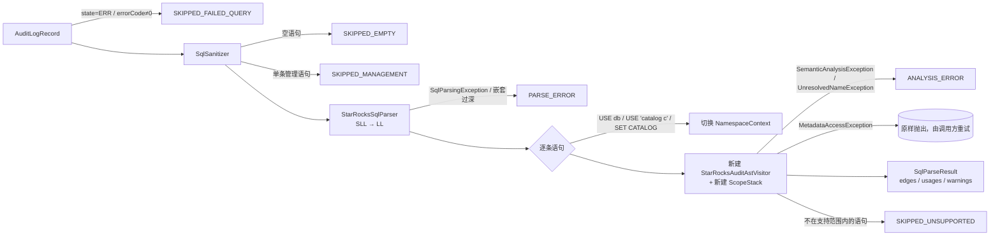

# Stage 3：基于官方 `StarRocksBaseVisitor` 的核心 AST 解析器

> 状态：**已签字（SIGNED-OFF）**。`mvn test` 共 267 个用例全部通过，其中 Stage 3 新增 94 个。
> 代码位于 `com.starrocks.lineage.analyzer`：
> - `StarRocksAuditAstVisitor extends StarRocksBaseVisitor<Void>`，重写 79 个 `visitXxx`；
> - 门面类 `StarRocksSqlAnalyzer`。
>
> 说明：branch-3.1 的 combined grammar 名为 `StarRocks`，生成的基类是 **`StarRocksBaseVisitor`**，规范中写的 `StarRocksParserBaseVisitor` 在 3.1 中并不存在（见 Stage 1 R-01）。

---

## 📐 STEP 1：【首席架构师】架构设计与契约定义

### 1.1 分析流程

### 1.2 状态机：三个显式栈加一个返回寄存器

| 状态 | 作用 | 入栈时机 | 出栈时机 |
|---|---|---|---|
| `ScopeStack`（Stage 2） | 命名空间 | 查询块、WITH、Lambda、集合操作的 ORDER BY | try-with-resources，按后进先出校验 |
| `Deque<ClauseType>` | 子句上下文（铁律 #6） | 每次 `analyzeExpression(expr, clause, policy)`；OVER 内部依次压入 `WINDOW_PARTITION_BY` 和 `WINDOW_ORDER_BY` | `finally` 块 |
| `Deque<ExpressionSourceTracker>` | 当前表达式的血缘 | 每个子句表达式压入一个；Lambda 的数组实参使用私有 tracker | `finally` 块 |
| `AliasPolicy` | 别名可见性 | 每个子句单独设置，结束后恢复原值 | 同上 |
| `relationRegister` | 关系节点的"返回值"（生成的访问器返回 `Void`，只能借寄存器传递） | `visitQueryPrimaryDefault`、`visitSetOperation` 等写入 | 由 `relationOf()` 读取后清空 |

子查询会压入自己的子句。因此 `WHERE EXISTS (SELECT c1 FROM t2 WHERE t2.id = t1.id)` 中：
- `c1` 计入 **SELECT**；
- `t2.id` 和 `t1.id` 计入 **WHERE**。

### 1.3 查询块访问顺序

1. **FROM**
2. **WHERE**：`NONE`，结果计入控制列
3. **SELECT**：公布别名；排除 QUALIFY 的操作数
4. **GROUP BY**：`PREFER_INPUT`，支持序号，结果计入控制列
5. **HAVING**：`PREFER_INPUT`，结果计入控制列
6. **QUALIFY**：`PREFER_INPUT`，结果计入控制列
7. **ORDER BY**：`PREFER_ALIAS`，支持序号；**只有带 LIMIT 时**才计入控制列，因为此时排序列决定了哪些行能留下

如果查询主体不是普通查询块（例如集合操作或带括号的查询），ORDER BY 改为通过 `pushOutput(rel)` 在输出关系上解析。

### 1.4 节点访问矩阵（共 79 个重写，按类别列出要点）

| 类别 | 方法 | 规则 |
|---|---|---|
| 语句 | `visitQueryStatement`、`visitInsertStatement`、`visitCreateTableAsSelectStatement`、`visitCreateTemporaryTableStatement`、`visitCreateViewStatement`、`visitAlterViewStatement`、`visitCreateMaterializedViewStatement`、`visitSubmitTaskStatement`、`visitUpdateStatement`、`visitDeleteStatement` | 写入语句 → `emitLineage`；查询语句 → 记录用量；带 EXPLAIN/DESC/TRACE 前缀时跳过 |
| 查询结构 | `visitQueryRelation`、`visitWithClause`、`visitCommonTableExpression`、`visitQueryNoWith`、`visitQueryPrimaryDefault`、`visitQueryWithParentheses`、`visitSetOperation`、`visitQuerySpecification` | CTE 先分析主体、再注册；集合操作按位置合并 |
| SELECT | `visitSelectSingle`、`visitSelectAll` | 由查询块统一处理；`*` 经 `expandStar` 展开，并维护可靠前缀 |
| GROUP BY | `visitSingleGroupingSet`、`visitRollup`、`visitCube`、`visitMultipleGroupingSets` | 支持序号与别名，结果计入控制列 |
| FROM | `visitFrom`、`visitDual`、`visitRelations`、`visitRelation`、`visitJoinRelation`、`visitTableAtom`、`visitSubqueryWithAlias`、`visitInlineTable`、`visitTableFunction`、`visitNormalizedTableFunction`、`visitFileTableFunction`、`visitParenthesizedRelation` | 见下方说明 |
| 列引用 | `visitColumnRef`、`visitDereference` | 解引用链展平后统一寻址（3.1 中 `t.c` 本身就是一个 dereference 节点）；不是列引用的 base 按 EXPRESSION 处理 |
| 函数 | `visitAggregationFunctionCall`、`visitWindowFunctionCall`、`visitSimpleFunctionCall`、`visitOver`、`visitLambdaFunctionExpr`、`visitInformationFunction`、`visitSpecialDateTime`、`visitSpecialFunction`、`visitExtract`、`visitGroupingOperation` | 见下方说明 |
| 子查询 | `visitExists`、`visitSubqueryExpression`、`visitScalarSubquery`、`visitInSubquery`、`visitTupleInSubquery` | 见下方说明 |
| 运算符 | `visitPredicate`、`visitLogicalNot`、`visitLogicalBinary`、`visitIsNull`、`visitComparison`、`visitInList`、`visitBetween`、`visitLike`、`visitArithmeticBinary`、`visitArithmeticUnary`、`visitConcat`、`visitCollate`、`visitCast`、`visitConvert`、`visitSimpleCase`、`visitSearchedCase`、`visitArrayConstructor`、`visitMapConstructor`、`visitCollectionSubscript`、`visitArraySlice`、`visitArrowExpression`、`visitOdbcFunctionCallExpression` | 一律按 EXPRESSION 处理；CASE 的条件和分支都计为 DIRECT |
| 叶子节点 | `visitLiteral`、`visitUserVariableExpression`、`visitSystemVariableExpression`、`visitParenthesizedExpression` | 常量；括号是透明的 |

**FROM 类方法补充说明**：
- `JOIN` 的 ON 和 USING 在两侧都可见时分析；
- SEMI/ANTI JOIN 在分析完连接条件后，隐藏输出中不包含的那一侧；
- UNNEST 等表函数的实参计入 `TABLE_FUNCTION` 子句；
- VALUES 的每一列取各行同位置表达式的并集。

**函数类方法补充说明**：
- 带 OVER 的函数按 WINDOW 处理；
- 66 个 StarRocks 聚合函数名（包括以 `simpleFunctionCall` 形式解析的，如 `approx_count_distinct`）按 AGGREGATION 处理；
- 其他函数按 EXPRESSION 处理；
- Lambda 形参按位置绑定到非 Lambda 实参，参数个数不一致时绑定到所有实参的并集。

**子查询类方法补充说明**：
- 标量子查询：输出计为 DIRECT，控制列计为 INDIRECT；
- EXISTS 和 IN：子查询的全部来源（输出和控制列）计为 INDIRECT。

### 1.5 DIRECT / INDIRECT 与 TransformType 判定规则

`emitLineage` 先把目标列与源关系**按位置**对齐（铁律 #3），只对齐可靠前缀内的列，然后对每个目标列生成边：

| 边 | 来源 |
|---|---|
| `DIRECT` + 逐源 `TransformType` | 字段的 `direct`：裸列为 IDENTITY；有运算或函数为 EXPRESSION；聚合内为 AGGREGATION；OVER 内为 WINDOW；跨层取支配者 |
| `DIRECT` + `CONSTANT`（源为 `__constant__`） | 字段没有任何物理源时，例如字面量、`COUNT(*)`、`RANK()`，这样目标列在血缘图中不会消失；表达式文本保存在 `transform_expr` 中 |
| `INDIRECT` | ①字段自身的 `indirect`（窗口 PARTITION/ORDER BY、子查询谓词）；②关系的控制列（WHERE、JOIN、GROUP BY、HAVING、QUALIFY、ORDER BY+LIMIT、SEMI 连接、各层子查询的谓词） |

各写入语句的目标列来源：

| 语句 | 目标列 |
|---|---|
| `INSERT INTO/OVERWRITE t (cols)` | 显式给出的列 |
| `INSERT INTO t SELECT/VALUES` | 目标表的元数据列序；元数据缺失时按查询输出列名，并记一条告警 |
| CTAS | `(k, v)` 列表，否则用查询输出名 |
| CREATE/ALTER VIEW、CREATE MATERIALIZED VIEW | `columnNameWithComment` 列表，否则用查询输出名 |
| UPDATE | SET 中被赋值的列；`DEFAULT` 记为常量 |
| DELETE | 目标表的所有列，全部为 INDIRECT；元数据缺失时目标列记为 `*` |
| SUBMIT TASK | 委托给内部的 CTAS 或 INSERT 处理，`stmt_type` 记为 `SUBMIT_TASK` |

**用量统计**（仅限查询语句）：每次解析到一个引用，就把它的全部物理来源（direct 和 indirect）计入当前子句。
- Lambda 形参引用的数组实参已经单独计数过，因此不再重复计数；
- 通过派生列引用时，外层子句会归到底层物理列上。

### 1.6 降级而非失败（`SqlParseResult.warnings` / `isDegraded()`）

| 情况 | 处理方式 |
|---|---|
| 表没有元数据 | 作为开放关系，引用到的列按需生成，同时记一条告警 |
| `*` 覆盖了元数据缺失的表 | 可靠前缀截断，不猜测后面的位置，同时记一条告警 |
| 列在元数据中缺失（元数据过期，但语句在 StarRocks 上执行成功了） | 宽松模式（默认）：通过限定前缀或块内唯一的物理表归属该列，并记一条告警；严格模式：判为 `ANALYSIS_ERROR` |
| 目标列数与查询输出列数不一致 | 按较小的数量对齐，并记一条告警 |

---

## 💻 STEP 2：【核心开发工程师】生产级代码实现

| 文件 | 内容 |
|---|---|
| `StarRocksAuditAstVisitor.java` | 79 个 `visitXxx`；子句栈、tracker 栈、别名策略、关系寄存器；`emitLineage`；VALUES 处理；宽松解析；名字和文本工具（支持 `DOT_IDENTIFIER`、反引号、原始文本截取） |
| `StarRocksSqlAnalyzer.java` | 门面类：过滤 → 清洗 → 解析 → 逐语句分析，处理命名空间切换和多语句合并；异常分类（PARSE_ERROR、ANALYSIS_ERROR、元数据异常原样抛出） |
| `SqlParseResult`（Stage 1 扩展） | 增加 `warnings` 和 `isDegraded()` |
| `ScopeStack`（Stage 2 扩展） | 增加 `resolvePhysicalRelation`：写入目标表不会被同名 CTE 屏蔽 |
| `SqlSanitizer`（Stage 1 扩展） | 增加 `hasMultipleStatements()`，见 R3-02 |

测试（94 个）：
- `QueryUsageAnalysisTest`（15 个）：铁律 #6、#7，各类子句、窗口、QUALIFY、UNNEST、Lambda、关联子查询、派生列、集合操作、SEMI 连接、struct、外部 catalog、屏蔽、EXPLAIN。
- `WriteLineageAnalysisTest`（14 个）：每类写入语句、CTE 链加窗口、带列表的 OVERWRITE 加 `t1.*`、目标表列序、ORDER BY+LIMIT、VALUES 中的子查询、UPDATE、DELETE、SUBMIT TASK、UNNEST 加 Lambda、ANTI JOIN 加 EXISTS、同一个源同时产生 DIRECT 和 INDIRECT。
- `StarRocksSqlAnalyzerFacadeTest`（12 个）：审计记录入口、各类跳过、错误分类、多语句与命名空间切换、元数据异常重抛、宽松与严格模式、未知表降级、`PIPES_AS_CONCAT`。
- `VisitorNodeMatrixTest`（53 个）：铁律 #1，用反射检查节点矩阵中的方法是否都被重写。

---

## 🔍 STEP 3：【首席架构师】Code Review 与【核心开发工程师】修正闭环

### 3.1 发现与修正（均由端到端冒烟实测发现）

| # | 级别 | 铁律 | 发现 | 修正 | 验证 |
|---|---|---|---|---|---|
| R3-01 | 阻断 | #1 | 3.1 语法 `QUALIFY qualifyFunction=selectItem …` 中，QUALIFY 的操作数**本身也是 `querySpecification` 的一个 `selectItem` 子节点**，所以 `ctx.selectItem()` 会把它一并返回。结果 `QUALIFY rn = 1` 被当作第三个投影列，`rn` 出现两次，报"别名歧义"。 | 构造 SELECT 列表时排除 `ctx.qualifyFunction`。 | `windowPartitionAndOrderAndQualify` |
| R3-02 | 主要 | 过滤规则 | `USE dw; INSERT …` 这类多语句文本，因为首个关键字是 USE，被整体当作管理语句跳过，导致 INSERT 丢失。 | `SqlSanitizer` 增加 `hasMultipleStatements()`（识别引号和 hint 之外的分号），只有**单条**管理语句才在解析前跳过；多语句文本逐条处理：USE 和 SET CATALOG 切换命名空间，EXPLAIN 由访问器跳过。 | `multiStatementTextSwitchesNamespace`、`explainInsideMultiStatementTextIsSkippedByTheVisitor` |
| R3-03 | 主要 | 命名空间 | 3.1 中 `USE CATALOG` 的语法是 `USE string`（例如 `USE 'catalog hive'`），`SET CATALOG` 是 `identifierOrString`。初版按拼接后的文本截取，结果不可靠。 | 直接读取 `string()` 和 `identifierOrString()` 节点，去掉引号和 `catalog` 前缀。 | `multiStatementTextSwitchesNamespace` |
| R3-04 | 次要 | 血缘 | `INSERT … VALUES (1, 2), (3, (SELECT …))` 中，`total` 的血缘来自第 2 行的子查询，但 `transform_expr` 取的是第 1 行的常量 `2`。 | 改为取第一个带物理来源的行表达式。 | `insertValuesWithScalarSubquery` |
| R3-05 | 次要 | 可观测性 | 表缺少元数据时，告警里显示的是别名而不是表的全名。 | 改为显示限定表名。 | `unknownTablesDegradeGracefully` |
| R3-06 | 设计决策 | 血缘 | `COUNT(*)`、`RANK()` 等没有物理源列。如果不生成边，目标列会从血缘图中消失；如果生成 AGGREGATION 边，又违反"常量源必须对应 CONSTANT"这一不变式。 | 生成源为 `__constant__` 的 CONSTANT 边，`transform_expr` 保留原始表达式（如 `COUNT(*)`）；行来源依赖通过 INDIRECT 边表达。 | `ctasWithAndWithoutColumnList` |
| R3-07 | 接受风险 | #2 | 宽松模式下，如果一个非限定的过期列实际属于外层查询块（关联引用），会被归到内层唯一的物理表上。 | 只在 `COLUMN_NOT_FOUND` 时才触发，并且一定记录告警；对准确性要求高的场景可以开启严格模式。 | `lenientAndStrictResolutionOfStaleMetadata` |

另外验证了两类健壮性场景：
- 3000 层括号嵌套：返回 `PARSE_ERROR: statement nesting too deep`，进程不崩溃；
- 元数据基础设施故障：`MetadataAccessException` 原样抛出，交给 Stage 4 重试，不会写入错误结果。

### 3.2 铁律逐条核查

1. **节点对齐**：79 个重写全部使用 3.1 生成的真实方法名（反射测试 53 项）。规范中的 `visitFromClause`、`visitUnnestRelation`、`visitLateralView`、`visitDereferenceExpression` 在 3.1 中不存在，已分别映射为 `visitFrom`/`visitDual`、`visitTableFunction`、`relations`/`joinRelation` 中的 LATERAL 关键字、`visitDereference`。✅
2. **CTE 与作用域**：
   - c2 引用 c1 的 CTE 链组合正确，`amount` 记为 AGGREGATION，`dt` 和 `user_id` 计入 INDIRECT；
   - 内层同名 CTE 和同名别名会屏蔽外层，有端到端用例；
   - 每条语句结束时都调用 `stack.assertEmpty()`。✅
3. **`*` 与省略列名的 INSERT**：
   - 不带列名的 INSERT 按目标表的元数据列序对齐；
   - INSERT 带列名时，`t1.*` 按位置对应到这些列；
   - 未知表上的 `*` 不做任何猜测。✅
4. **集合操作**：`ALTER VIEW … UNION ALL` 中，名字不同的两个分支都会合并到 `id`。✅
5. **UNNEST、Lambda、窗口函数、CASE**：
   - `t.e` 正确还原为 `items.arr1`（EXPRESSION）；
   - `(x, y) -> x * y` 不会误判为 `items.x`；
   - RANK 的 PARTITION BY 和 ORDER BY 计入 INDIRECT；
   - CASE 的条件和分支都计为 DIRECT。✅
6. **子句栈**：EXISTS 内层的 SELECT 和 WHERE 各自归类；HAVING 计入 group_by，窗口 ORDER BY 计入 order_by，QUALIFY 计入 where，PARTITION BY 计入 group_by。✅
7. **单 Query 去重**：`SELECT a, a + 1 FROM t WHERE a > 10` 中，`access=1`、`select=1`、`where=1`，原始出现次数 `SELECT=2`。✅
8. **零占位符**：`grep` 检查确认没有 TODO 或省略。唯一的 TODO 来自上游 `.g4`，属于官方原文。✅

### 3.3 签字

【首席架构师】Stage 3 **APPROVED**。

进入 Stage 4 的约束：
- Pipeline 只消费 `SqlParseResult`：SUCCESS 入库；`isDegraded()` 的结果入库并上报指标；`MetadataAccessException` 触发重试，并且**不推进水位**；
- 用量按 `(stat_hour, column, user)` 预聚合。
