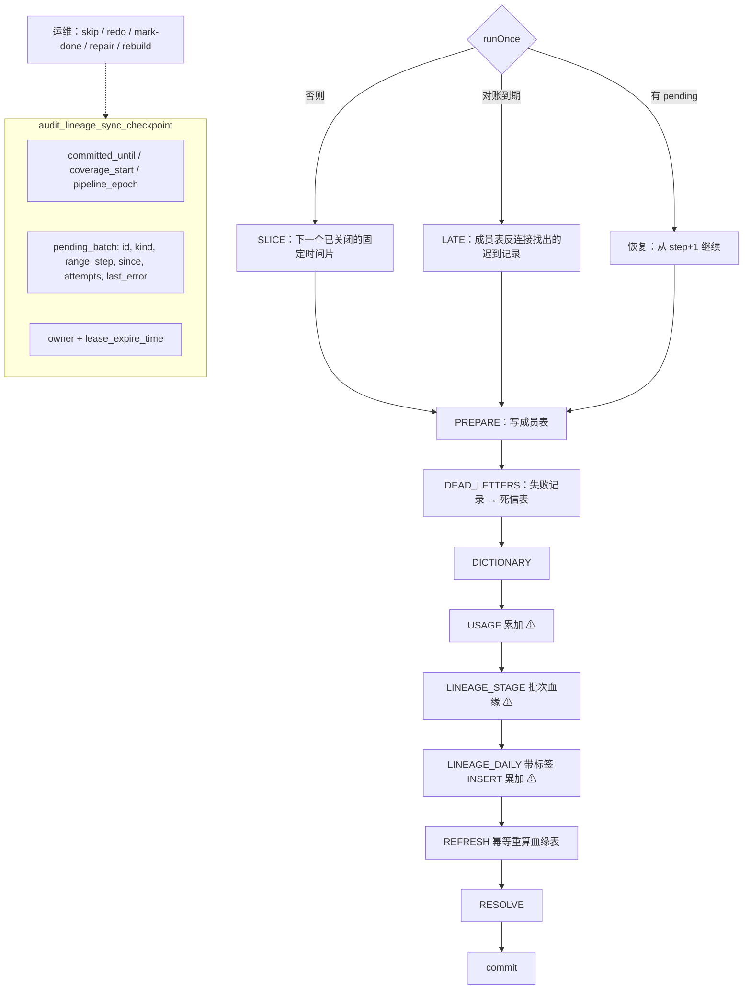

# Stage 5：可靠性加固（缺口 1–7）

> 状态：**终审签字（FINAL SIGN-OFF）**。`mvn verify -Pit` 中单元测试和 StarRocks 3.1.17 容器集成测试全部通过（数字见 `docs/container-verification.md`）。
> 代码位于 `com.starrocks.lineage.pipeline`，DDL 位于 `sql/ddl/00..09`。
> 本文同时**更正** Stage 4 中两条错误结论：R4-09"迟到数据风险可忽略"和 R4-10"租约只影响吞吐、不影响正确性"（见 3.4）。

本阶段要修复的 7 个缺口：

| # | 缺口 | 后果 |
|---|---|---|
| 1 | 首次运行跨天卡死：用量表的动态分区只覆盖今天到 +3 天，而默认起点是"现在 − 1 天" | 昨天的行被 StarRocks 拒绝，批次永远失败 |
| 2 | 毒批次永久阻塞：一条坏记录或一行被拒的数据会让整个批次一直失败 | 水位停滞，后面的数据全部积压 |
| 3 | 多实例或暂停的僵尸实例没有隔离（fencing）；用户 id 计数器存在竞态 | 重复写入；两个用户拿到同一个 id，精确 UV 被合并 |
| 4 | 重放依赖 StarRocks 标签保留期（`label_keep_max_second` = 259200 秒 = 3 天，已在 3.1.17 上实测） | 超过 3 天后恢复的批次会被重复累加 |
| 5 | 重放不确定：两次尝试之间元数据可能变化；分块导入不是原子的 | 部分写入加上不同的重算结果，数据重复或丢失 |
| 6 | 晚于 `lateArrival` 才到达审计表的记录被跳过，且没有对账 | 静默丢数 |
| 7 | 失败记录没有保存，也没有重算或重建工具 | 修好分析器后无法补算 |

---

## 📐 STEP 1：【首席架构师】架构设计与契约定义

### 1.1 总体思路

把"一个周期"改造成**持久化的批次状态机**：

- 批次在写入任何数据之前先声明（意图），并记录种类和审计时间范围；
- 每一步都是**一次原子写入**，带有由批次 id 派生的标签；
- 检查点记录每个**已完成的步骤**，恢复时从下一步继续；
- 恢复时读取的数据集与第一次尝试**完全相同**：成员表记录了"哪个批次处理了哪条审计记录"；
- 累加型写入在超过标签保留期后，恢复前要先询问 FE 标签状态，不靠猜。



⚠ 表示累加型步骤：恢复时如果这一步可能已经执行过，先查 `get_load_state`。

### 1.2 缺口到设计的映射

| # | 设计 | 落点 |
|---|---|---|
| 1 | 用量表、日事实表、成员表、批次血缘表一律使用**表达式分区** `PARTITION BY date_trunc('day', col)` 加 `partition_live_number`，由导入自动建分区，任何一天都能写入（已实测：昨天和 100 天前的分区均自动创建）。批次按**固定的、对齐整点的时间片**（默认 5 分钟）推进，只处理"片尾 ≤ 现在 − lateArrival"的时间片；连续的空时间片合并成一次提交 | DDL 02/03/06/07；`PipelineConfig.sliceSize`、`nextSlice` |
| 2 | 每条记录单独兜底：解析或分析失败 → `PARSE_ERROR` / `ANALYSIS_ERROR` 死信（保存完整审计记录），批次照常提交；分析器内部异常也是如此。被 StarRocks 拒绝的行：先严格导入，失败时写 `LOAD_FILTERED` 死信（标签和错误日志 URL），再用**同一标签**加 `max_filter_ratio=1` 导入其余行（已实测：失败导入的标签可以复用）。元数据权限不足视为"无元数据"并降级。真正的批次级失败只计入 `attempts`，超过阈值输出 ALERT，并报告 `BLOCKED`；**任何数据都不会被自动跳过**，由运维决定 `skip` | `StarRocksSink.load`、`Accumulator`、`execute`、`skipPendingBatch` |
| 3 | 每一步写入前都调用 `verifyLease`（读-改-写，校验 owner 并续约）；每次步骤推进也在 owner 校验下写入。SLICE 的 id 是 (pipeline, epoch, 时间片) 的确定性哈希，所以暂停的实例在剩余窗口内泄漏出的那一次写入，用的是同一批次同一步骤的标签，会被 StarRocks 丢弃。用户 id 改为 `SHA-256(user)` 的前 63 位，无状态，所有实例算出的值相同 | `JdbcCheckpointStore.mutate`、`UserIds` |
| 4 | 恢复时，**只有紧跟在已持久化步骤之后的那一步**可能执行过（步骤严格按序执行）。对其中的累加型步骤调用 `get_load_state`：COMMITTED → 跳过；IN_PROGRESS → 可重试；ABORTED → 执行；UNKNOWN 且仍在 `labelRetention`（默认 2 天，小于 FE 的 3 天）内 → 执行；UNKNOWN 且已超过保留期 → `BatchBlockedException`，由运维在核对数据后选择 `mark-done` 或 `redo`（`redo` 会重置计时） | `mayWrite`、`resolveBlockedStep` |
| 5 | **成员表**：PREPARE 用一次原子导入写入批次的全部记录；恢复时从成员表读回，而不是重新按范围读取。因为成员导入是原子的，INTENT 状态下只要发现任何成员，就说明导入已完成。**冻结死信**：本批次之前尝试中已进入死信的记录不再分析。**冻结血缘**：LINEAGE_STAGE 之后不再分析，日事实由已持久化的批次血缘派生，血缘表由日事实重算。**每步一次导入**（不再分块）。恢复时如果某条记录这次分析失败，但它的贡献已被早先的尝试写入（查询已写入用量、写语句已写入批次血缘），就不再写死信，否则修复会重复计数 | DDL 06/07；`readMembers`、`frozenDeadLetters`、`writeFailures` |
| 6 | **对账**：每隔 `reconcileInterval`（15 分钟）对 `[max(coverage_start, committed_until − reconcileWindow), committed_until)`（24 小时）做反连接 `LEFT ANTI JOIN audit_lineage_batch_member`，找到的记录作为 LATE 批次处理。没有找到时记录 `last_reconcile_time` | `declareLate`、`JdbcAuditLogSource.fetchUnprocessed` |
| 7 | 死信表保存完整审计记录。`repairDeadLetters(from, to, limit)`：OPEN → REPAIRING（保留）→ 重新分析 → 成功的变为 RESOLVED，再次失败的回到 OPEN 并更新错误信息。`rebuild(fromDay, toDay)`：先核对成员数与仍存在的审计记录数（审计保留期检查），再记录这些天里所有的边以便刷新，清除用量和日事实，然后从成员表分页重算；同时把这些天中重新分析成功的旧死信标记为 RESOLVED。两者在分析前都会清空元数据缓存 | `repairDeadLetters`、`rebuild`、`resolve` |

### 1.3 存储模型（`sql/ddl`）

| 文件 | 表 | 模型 | 作用 |
|---|---|---|---|
| 01 | `audit_column_lineage` | PK(edge_id) | 日事实的**投影**：MIN 首次时间、MAX 末次时间、SUM 次数，其他属性取最新一天。不再增量累加，也没有 `last_batch_id` |
| 02 | `audit_column_lineage_daily` | AGG(stat_day, edge_id)，SUM / MIN / MAX / REPLACE | 血缘的唯一事实来源，可按天清除和重建 |
| 03 | `audit_column_hourly_usage` | AGG，表达式分区，400 天 | 不变（只是分区方式改变） |
| 04 | `audit_user_dict` | AGG(user_name, user_id)，first_seen MIN | 反查表和碰撞监控 |
| 05 | `audit_lineage_sync_checkpoint` | PK(pipeline_name) | 新增 `committed_until`、`coverage_start`、`pending_*`（种类、范围、步骤、since、attempts、last_error）、`last_reconcile_time`、`pipeline_epoch` |
| 06 | `audit_lineage_batch_member` | PK(pipeline, query_id, audit_time)，400 天 | 精确重放、对账、重建 |
| 07 | `audit_lineage_batch_lineage` | PK(batch_id, edge_id, stat_day, refresh_only, batch_time)，30 天 | 冻结的批次血缘；`refresh_only` 行列出重建涉及的边 |
| 08 | `audit_lineage_dead_letter` | PK(pipeline, query_id, kind) | 死信 |
| 09 | `audit_lineage_batch_log` | PK(batch_id) | 每个已提交批次的统计 |

删除了 Stage 4 的 `audit_column_lineage_stage` 与 `audit_lineage_merge_log`。

### 1.4 契约

```java
interface CheckpointStore {
    boolean tryAcquireLease(String p, String owner, Duration ttl, LocalDateTime initialStart);
    void verifyLease(String p, String owner, Duration ttl);              // LeaseLostException
    void releaseLease(String p, String owner);
    void savePending(...); void advanceStep(..., BatchStep step); void restartPendingClock(...);
    void recordFailure(..., String error);
    void commit(..., String batchId, LocalDateTime newCommittedUntil /* null: LATE/REPAIR/REBUILD */, long records);
    void markReconciled(..., LocalDateTime at);
}
interface AuditLogSource {   // 全部按 (timestamp, queryId) 做 keyset 分页
    fetchRange / fetchMembers / fetchProcessed / fetchUnprocessed / countMembers / countProcessed
}
interface AuditLineageSink {  // 每个方法是一次原子写入，标签 = label(batchId, step)
    writeMembers / writeDeadLetters / writeUserDictionary / writeUsage⚠ / writeBatchLineage⚠ /
    recordEdgesForRefresh / insertDaily⚠ / refreshLineage / purgeUsage / purgeLineageDaily /
    deadLetters / deadLettersOfBatch / loadState / writeBatchLog / userIdCollisions
}
```

异常分类：`PipelineException.isRetryable()`。`LeaseLostException`（停止写入）、`BatchBlockedException`（需要运维决定）、`DataQualityException`（无法隔离的坏数据）不可重试；其余异常，包括驱动、连接池等意外异常，一律视为暂时性故障，每个周期重试，超过 `alertAfterAttempts` 次后输出 ALERT。

### 1.5 运维操作

| 情况 | 现象 | 操作 |
|---|---|---|
| 批次在累加型步骤上被阻塞（标签已过保留期） | `BLOCKED`，消息包含 "label retention" | 按 `pending` 中的 `[range_start, range_end)` 和步骤核对目标表：USAGE 看该时间段的用量是否已包含这批记录，LINEAGE_STAGE 看 `audit_lineage_batch_lineage` 中是否有该 `batch_id`，LINEAGE_DAILY 看日事实。数据**在** → `mark-done`；**不在** → `redo` |
| 批次反复因同一个不可重试错误失败 | `BLOCKED`，`attempts` 不断增加，有 ALERT 日志 | 先修复原因（权限、表结构等），下一周期会自动重试。确实无法处理时用 `skip`（必须给出原因，会写入 `BATCH_SKIPPED` 死信）。SLICE 的成员会被写入，所以对账不会再拾取这些记录；之后可以对这些天执行 `rebuild` |
| 修复分析器或补齐元数据之后 | 死信表中有 OPEN 的 `PARSE_ERROR` / `ANALYSIS_ERROR` | `repair`，指定审计时间范围 |
| 分析器逻辑变更后，需要重算历史 | — | `rebuild`，按整天进行；如果这些天的审计记录已经超过审计表保留期，操作会被拒绝 |
| 用户 id 碰撞监控 | `userIdCollisions()` 非空（概率约 5e-8 / 百万用户） | 通过 `bitmap_to_array` 反查，评估影响 |

`scripts/smoke/smoke-ops.jsh` 提供 `status` / `redo` / `mark-done` / `skip` / `repair` / `rebuild` 六个操作。

---

## 💻 STEP 2：【核心开发工程师】生产级代码实现

| 文件 | 内容 |
|---|---|
| `BatchKind`、`BatchStep` | 批次种类（只有 SLICE 推进水位）；步骤顺序 |
| `CheckpointStore` / `JdbcCheckpointStore` | 每次变更都是"读 → 校验 owner → 修改并续约 → 写 → 回读"；提交单调；`pipeline_epoch` 在创建检查点时随机生成 |
| `AuditLogSyncPipeline` | 状态机（`doExecute`）、SLICE / LATE 声明、标签守卫 `mayWrite`、冻结死信、`writeFailures` 的贡献判定、运维操作、按内容哈希分块写死信、关闭时释放租约 |
| `AuditLogSource` / `JdbcAuditLogSource` | 范围读取、成员 JOIN、`LEFT SEMI` / `LEFT ANTI JOIN`、成员数与审计数的核对 |
| `AuditLineageSink` / `StarRocksSink` | 每步一次导入；按 UTF-8 字节截断；严格导入 → `LOAD_FILTERED` 死信 → 同一标签容错导入；带标签的 `INSERT`（"has already been used" 视为已完成）；刷新的 upsert 和删除 |
| `StreamLoadClient` | `max_filter_ratio`、`DataQualityException`、`loadState`（`GET /api/{db}/get_load_state`） |
| `DeadLetter`、`BatchLogEntry`、`UserIds`、`LeaseLostException`、`BatchBlockedException` | 新增 |
| `StarRocksSqlAnalyzer` | 兜底捕获 `RuntimeException`（`MetadataAccessException` 除外），转为 `ANALYSIS_ERROR` |
| `JdbcStarRocksMetadataProvider` | 1044 / 1142 / 1227 或 "access denied" 视为"没有元数据" |
| 删除 | `UserDictionary`（计数器）、stage 与 merge_log 表 |

测试：

| 类 | 用例 | 内容 |
|---|---|---|
| `AuditLogSyncPipelineTest` | 7 个嵌套组 | 每个缺口一组，基于 `FakeWarehouse`（用内存实现 StarRocks 的 SUM / PK / 标签去重语义，支持 `failBefore` / `crashAfter` / `beforeOp` 故障注入）和 H2 上的 `JdbcCheckpointStore` |
| `JdbcCheckpointStoreTest` | 3 | 首次创建与 epoch、步骤 / 失败 / 提交 / 单调性、隔离 / 接管 / 释放 |
| `StreamLoadClientTest` | 7 | 重定向、标签、被拒行与同标签容错导入、`get_load_state` 映射、行映射 |
| `StarRocksStorageIT` | 11 | 上面每一条 SQL 和导入在 3.1.17 上实际执行 |
| `PipelineEndToEndIT` | 7 | 首次跨天、在每个累加步骤后崩溃并重放、标签过保留期、迟到记录、僵尸实例、修复、重建 |
| `SmokeRunbookIT` | 1 | 新版 Runbook 全流程（包括 `smoke-ops.jsh`） |

---

## 🔍 STEP 3：【首席架构师】Code Review 与【核心开发工程师】修正闭环

### 3.1 评审发现与修正

S5-01 至 S5-05 来自代码评审和单元测试；S5-06 至 S5-09 只有在**真实 StarRocks 3.1.17 容器**上才暴露出来。

| # | 级别 | 发现 | 修正 | 验证 |
|---|---|---|---|---|
| S5-01 | 阻断 | 成员导入已提交、但步骤还没来得及记录时进程崩溃。恢复时步骤仍是 INTENT，代码重新按范围读取，导致期间新到的记录被分析并计入用量，而它并不是成员 | INTENT 状态下先读成员表；只要有成员，就说明那次原子导入已完成，直接推进到 PREPARE 并以成员为准 | `aResumedBatchProcessesExactlyItsMembers`、IT `crashesAfterEachAdditiveStepAreReplayedExactlyOnce`（writeMembers） |
| S5-02 | 阻断 | REPAIR 的保留（REPAIRING）是分块写入的。INTENT 状态下恢复时，只分析了仍为 OPEN 的那部分，已保留的那部分会在 RESOLVE 时被标记为已解决，但从未被计入 | 保留之后一律用 `reserved(p)`（REPAIRING 且 repair_batch_id = 本批次）作为输入 | `repairInterruptedAfterReservationResumes` |
| S5-03 | 阻断 | "这条失败记录的贡献是否已写入"按已持久化的步骤判断，但用量导入可能已经提交、只是步骤没记上，于是同一条查询既被计入用量，又成为死信，修复时会重复计数 | 写死信之前先通过标签守卫判断 USAGE 和 LINEAGE_STAGE 是否已写入；查询看前者，写语句看后者 | `aQueryFailingOnlyOnReplayAfterUsageIsNotDeadLettered` |
| S5-04 | 阻断 | REBUILD 和 REPAIR 的 id 由定义推导：同一秒内对同一范围重建两次、或再次修复同一组死信，会得到相同的 id 和标签。结果是清除操作照常执行，而后续导入全部被当成"标签已存在"跳过，数据丢失 | 除 SLICE 外，所有批次的 id 都加入随机分量（id 本身会持久化，恢复不受影响） | `rebuildRecomputesDaysExactlyAndSurvivesACrash`（连续两次重建） |
| S5-05 | 主要 | 守卫最初对每个累加步骤都询问标签：一个批次如果在更早的步骤上阻塞超过 2 天，到 USAGE 时会因为"标签未知"被误判为阻塞 | 步骤严格按序执行，所以只有紧跟在已持久化步骤之后的那一步可能执行过，只对这一步询问；另外，本批次没有相关行时也不询问 | `loadStillInFlightIsRetriedLaterAndLaterStepsAreNotGuarded` |
| S5-06 | **阻断（真实引擎）** | SLICE 的 id 只由 (pipeline, 时间片) 决定。重置管道后（删除检查点、清空表），用同名重新启动，会生成与之前完全相同的 id。由于 FE 会记住标签 3 天，**所有导入都被当作"标签已存在"静默跳过**。容器测试中，成员没有写入，对账于是把刚处理过的记录又当作迟到记录处理了一遍 | 检查点新增 `pipeline_epoch`，在创建检查点时随机生成；SLICE 的 id = hash(pipeline, epoch, 时间片)。同一代检查点内仍是确定性的（多实例竞争时标签一致），重置后则不会再碰撞 | `aPipelineResetUnderTheSameNameGetsNewBatchIdsAndLabels`、IT 首次运行用例 |
| S5-07 | 主要（真实引擎） | 意外异常（不是 `PipelineException`）被当作不可重试，直接报告 BLOCKED 而不是重试，导致注入的"进程被杀"变成了阻塞 | 只有已知会以相同方式重复的失败才不可重试；其他异常都视为暂时性故障，每个周期重试并在达到阈值后告警 | IT 崩溃用例 |
| S5-08 | 主要（真实引擎） | `LOAD_FILTERED` 死信的批次 id 是从标签中截取第一个 `_` 之前的部分得到的；批次 id 一旦含有 `_` 就会出错 | 显式传入批次 id | IT `sinkWritesLoadFilteredEvidenceForRejectedUsageRows`（StarRocks 真实拒绝过长的列名） |
| S5-09 | 主要（真实引擎） | 修复和重建使用的是带缓存的元数据（正向缓存 10 分钟）：刚补齐表结构就执行修复，会因为读到旧的 schema 再次失败 | `repairDeadLetters` 和 `rebuild` 在分析前调用 `invalidateAll()` | IT `deadLettersAreRepairedOnceTheMissingObjectExists` |

### 3.2 已验证的引擎事实（3.1.17）

- 表达式分区的 AGGREGATE 表（含 BITMAP / HLL 列）和 PK 表都能由导入自动创建昨天及更早日期的分区。
- 63 位的用户 id 可以用于 `to_bitmap` / `bitmap_to_array`。
- 一次严格导入因数据质量失败后，同一标签可以再次用于 `max_filter_ratio=1` 的导入。
- `get_load_state` 对用过的标签返回 `VISIBLE`（Stream Load 和带标签的 INSERT 都是如此，0 行的 INSERT 也会注册标签），对从未用过的标签返回 `UNKNOWN`；`lineage_etl` 账号可以调用。
- 重复使用带标签 INSERT 的标签时报错 `Label [x] has already been used.`。
- `LEFT ANTI JOIN` / `LEFT SEMI JOIN`、在 AGGREGATE 表上按 key 范围 `DELETE`、在 PK 表上带子查询的 `DELETE`，都按预期工作。
- `label_keep_max_second` 为 259200 秒（3 天）。

### 3.3 铁律核查

1–7（语法与分析）不受本阶段影响，全部回归测试通过。8. 零占位符：已用 `grep` 检查，新代码中没有任何 TODO 或省略。✅

**并发**：分析线程池、聚合器的读写锁、周期互斥锁都沿用 Stage 4；运维操作与周期共用同一把锁，不会同时执行。✅
**幂等**：每一步要么由标签保护，要么是 PK upsert，要么是幂等重算；累加型步骤在恢复时由标签状态守卫。✅
**断言严密性**：每个缺口都至少有一个单元测试和一个真实引擎测试，断言精确计数（不使用"大于"之类的宽松断言），并在重放前后对完整快照做相等比较。✅

### 3.4 对 Stage 4 结论的更正

- **R4-10"租约只用来避免重复工作，正确性由批次意图和幂等写入保证"——错误。** 意图和标签只能保证同一批次被**同一个** id 重放；两个实例各自声明批次、一个暂停的实例在被接管后继续写入、或者基于计数器的用户 id 竞态，都会破坏正确性。Stage 5 的修正：每一步写入前都做隔离校验，SLICE 的 id 是确定性的（泄漏的写入会被标签去重），用户 id 改为无状态哈希。残余窗口（`verifyLease` 和写入之间发生暂停）只可能让同一批次同一步骤的写入泄漏，这种写入会被 StarRocks 的标签去重丢弃。
- **R4-09"迟到风险可以忽略"——错误。** 在高负载或插件积压时，审计写入完全可能晚于 `lateArrival`。Stage 5 改为用成员表反连接做对账，保证不丢。

### 3.5 终审签字

【首席架构师】Stage 5 **APPROVED**。7 个缺口全部关闭，每一个都有单元测试和真实 StarRocks 3.1.17 上的集成测试作为证据。真实引擎发现了 4 个替身无法暴露的问题（S5-06 至 S5-09），均已修复并加入回归测试。

剩余的接受项：
- 早于 `reconcileWindow`（24 小时）才到达的记录不会被自动对账，可以用 `rebuild` 补算；
- 日事实表中的属性列（REPLACE 语义）取"当天最后加载的批次"的值，而不是"当天最晚执行的语句"的值，计数不受影响。
